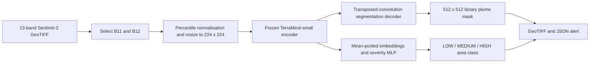
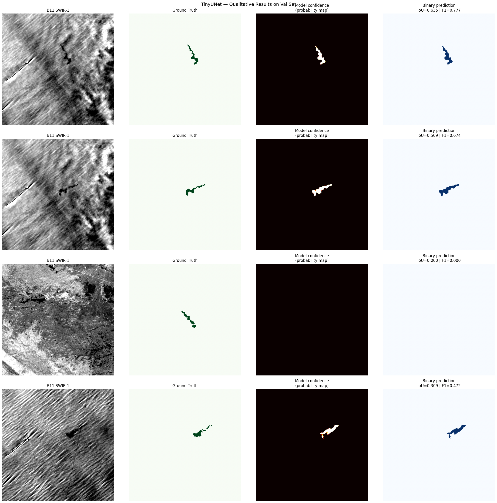

# Terramind

Satellite methane-plume segmentation with a frozen geospatial foundation model, a local inference API, and an interactive dashboard.

**Live demo:** [terramind-demo.streamlit.app](https://terramind-demo.streamlit.app/)

Terramind is the maintained home of the **MethanePulse** hackathon project. It takes a Sentinel-2 GeoTIFF, predicts a plume mask and a relative plume-size class, and exports a georeferenced mask plus a JSON alert. The model uses TerraMind-1.0-small through TerraTorch; the foundation model itself was developed by IBM, ESA, and Forschungszentrum Jülich.

## What you can run

- A Streamlit dashboard with sample-tile inference, tile uploads, an alert log, and a model-card view.
- A command-line inference script that writes a binary GeoTIFF mask and JSON alert.
- A Flask `POST /predict` endpoint for local multipart uploads.
- Five research notebooks covering data exploration, a spectral baseline, TinyUNet, and the TerraMind model.
- The original trained checkpoint, sample input, saved sample outputs, and experiment logs.

This is a research prototype. Severity is derived from mask area, not a measured methane emission rate. Satellite acquisition gaps, false positives, and performance on real plumes remain open problems. Read the [model card](docs/MODEL_CARD.md) before interpreting predictions. The inherited dashboard still contains historical model-card values; the model card in this repository records the evidence and discrepancies explicitly.

## Quick start

Use **Python 3.12**. The included checkpoint is approximately 85 MiB, so the initial clone is larger than a typical Python project.

```bash
git clone https://github.com/prithvi-kaizen/Terramind.git
cd Terramind
python3.12 -m venv .venv
source .venv/bin/activate
python -m pip install --upgrade pip
python -m pip install -r requirements.txt
python scripts/check_environment.py
python -m streamlit run app.py
```

Open [localhost:8501](http://localhost:8501), keep **Sample tile** selected, and click **Run Inference**. The included checkpoint supplies the complete encoder and head weights, so the maintained demo does not download model weights at runtime. The complete training dataset is unnecessary for this demo.

On Windows, activate with `.venv\Scripts\activate`. See [SETUP.md](docs/SETUP.md) for the API, notebook workflow, platform notes, and troubleshooting.

For hosting, use the [Streamlit Community Cloud deployment guide](docs/DEPLOYMENT.md) and `deployment/streamlit_app.py`. Its Linux requirements select CPU-only PyTorch, and the dashboard runs inference in one process.

### Command-line inference

```bash
python infer.py \
  --input sample_input/0___0_S2B_20240326T165849_R1000_nonorm_bands20m.tiff \
  --checkpoint terramind_methane_best.pt \
  --output outputs/demo \
  --threshold 0.5
```

The output directory contains `<tile>_mask.tiff` and `<tile>_alert.json`. Existing files with the same tile stem are overwritten. The runtime selects Apple MPS, CUDA, or CPU based on availability.

### Local API

```bash
python endpoint.py
```

In another terminal:

```bash
curl -X POST http://127.0.0.1:5001/predict \
  -F 'file=@sample_input/0___0_S2B_20240326T165849_R1000_nonorm_bands20m.tiff' \
  -F 'threshold=0.5'
```

The endpoint returns the alert JSON. This server is intended for local development; deployment hardening is part of the [implementation plan](docs/IMPLEMENTATION_PLAN.md).

## How the model works



The encoder produces patch embeddings. The segmentation branch has four transposed convolutions followed by a 1×1 convolution and interpolation. The severity branch uses mean-pooled patch embeddings, not a CLS token. Saved notebook output records 616,388 trainable head parameters; encoder weights remain frozen.

## Recorded experiments

These are **imported experiment records**, not independently reproduced benchmarks. The notebooks record a custom location-based split with 619 training tiles and 185 validation tiles. The published dataset's original split is different.

| Experiment | Recorded IoU | Recorded F1 | Evidence and interpretation |
| --- | ---: | ---: | --- |
| SWIR local-anomaly baseline | 0.1210 | 0.2080 | [Saved metrics](docs/physics_baseline_metrics.json); averages per tile; threshold selected on validation data |
| TinyUNet | 0.4897 | 0.6575 | [Saved metrics](docs/tinyunet_eval_metrics.json); global pixel aggregation; checkpoint absent |
| TerraMind notebook run | 0.3298 | Not recorded | [Notebook](notebooks/TerraMind.ipynb); averages batch IoU; best epoch 8 |
| Separate TerraMind log | 0.3257 | 0.5110 at best-IoU epoch | [Training log](docs/terramind_training_history.json); best IoU at epoch 6; checkpoint association unverified |

The aggregation rules differ, so these values do not establish a controlled comparison or a generalisation advantage. The separate log records severity accuracy as zero throughout; the notebook's severity accuracy at its best-IoU epoch is 0.395. Resolving this discrepancy is a first implementation milestone.

<details>
<summary>View the original TinyUNet qualitative results</summary>



Extracted unchanged from the saved output of `notebooks/TinyUNet.ipynb`. These are historical TinyUNet examples, including a missed plume, rather than newly executed TerraMind predictions.

</details>

## Data and repository layout

The project uses [GeoCH4PlumeNet](https://zenodo.org/records/16813369), which contains simulated plumes inserted into Sentinel-2 imagery. Full training data is external; the sample tile and checkpoint are included here. See [DATA.md](docs/DATA.md) for download and directory instructions.

```text
app.py                       Streamlit dashboard
infer.py                     CLI and shared model inference
endpoint.py                  Local Flask endpoint
src/alert_packet.py          Original notebook alert helper
notebooks/                   Research notebooks
sample_input/                Included Sentinel-2 sample
results/                     Imported sample mask and alert
terramind_methane_best.pt     Imported trained checkpoint
docs/                        Setup, model card, data guide, plan, logs
scripts/                     Environment and repository checks
tests/                       Runtime validation tests
.github/                     CI and contribution templates
```

## Development

```bash
python -m pip install -r requirements-dev.txt
python scripts/validate_repository.py
python -m pytest
```

The CI workflow checks notebook structure, repository assets, Python syntax, and the runtime validation tests without downloading model weights. It does not reproduce training or establish model quality. Read [CONTRIBUTING.md](CONTRIBUTING.md) before changing data processing or metrics.

## Next steps

The [implementation plan](docs/IMPLEMENTATION_PLAN.md) prioritises checkpoint provenance, consistent evaluation, reproducible training, robust inference, and a documented demo. Temporal imagery, calibrated emission estimates, and embedded deployment are later research work.

## Attribution and licensing

Foundation model: [TerraMind-1.0-small model card](https://huggingface.co/ibm-esa-geospatial/TerraMind-1.0-small). Framework: [TerraTorch](https://github.com/torchgeo/terratorch).

The project has no project-level license file. No new license is assigned to the code, checkpoint, or data in this setup. See [PROVENANCE.md](docs/PROVENANCE.md) for artifact hashes and the remaining licensing decision.
