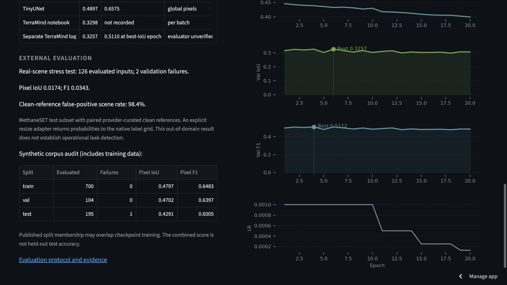

# Public-data evaluation protocol

This protocol evaluates the existing checkpoint at threshold 0.5 without retraining, threshold searches, or changing the live app's preprocessing. The two experiments answer different questions.

## Complete synthetic dataset audit

Download all three archives from [GeoCH4PlumeNet v1](https://zenodo.org/records/16813369), verify the publisher's MD5 checksums, and evaluate every included image with its matching ground-truth mask. Read TIFFs directly from each archive to avoid maintaining an additional extracted copy. Convert labels with the historical rule `mask > 0.5`; check image/label shape, CRS, and transform before counting pixels. Record failed inputs rather than substituting predictions or ignoring failures silently.

Report global pixel IoU/F1, mean tile IoU, scene counts, and any-mask-overlap counts by published split. Also audit location/plume identifiers shared between published splits and report the historical location-8/9 subset. These are descriptive measurements of a preserved checkpoint: its training-run association is unknown, and evaluating training images does not establish held-out performance. Keep the combined full-corpus score separate from the published test split. Report scene precision as unavailable when there are no negative scenes.

## Real-plume cohort

Use [MethaneSET s2-finetune](https://huggingface.co/datasets/tacofoundation/methaneset), which contains MARS plume masks and provider-curated clean references, under CC BY-NC-SA 4.0. Resolve and save the immutable Hugging Face revision before acquiring data. Select 64 entries from its test split, restricted to catalog sensors `S2A` and `S2B`, in ascending SHA-256 order of `terramind-real-v1:` plus the sample ID. Save the cohort before model predictions. Evaluate each target and its `bg0` reference, with the reference treated as a provider-labeled negative. Do not infer negatives from missing detections.

The subdataset README contains copied Landsat descriptions. The actual catalog and a downloaded archive identify 13-band Sentinel-2 rasters with B11/B12 at positions 12/13. The evaluator restricts the catalog sensor, checks the TIFF band count, shape and valid pixels, and requires alignment with the plume mask. It uses the catalog's TIFF byte offsets to fetch only target, reference, and label data; no full multi-gigabyte country archive is needed. Exact HTTP range responses and source hashes are verified and recorded.

These real chips cover 200 by 200 pixels at 10 m, while the demo accepts 512 by 512 tiles. The offline adapter preserves the geographic footprint, bilinearly resizes all bands to 512 by 512, applies the existing model preprocessing, then bilinearly returns predicted probabilities to the original grid before thresholding at 0.5. Ground-truth masks stay on the native grid. This is an explicitly out-of-domain stress test with different spatial context and effective resolution, not an operational Sentinel-2 validation or a reproduction of the dataset authors' benchmark. No adapter setting is selected using its test results.

Report positive and negative scene counts, scene recall/precision, false-positive scene rate, global pixel IoU/F1 and individual outcomes. A detection anywhere in the scene is weaker evidence than overlap with the annotated plume; report both. Correlated observations/sites and the modest subset size limit statistical independence. Provider-curated references have not been independently reviewed by this project.

## Reproduce

Install the normal CPU deployment requirements, then run:

```bash
HF_HUB_OFFLINE=1 python scripts/evaluate_public_data.py synthetic \
  --data data/raw/evaluation --output outputs/public-evaluation --remove-archives
HF_HUB_OFFLINE=1 python scripts/evaluate_public_data.py real \
  --data data/raw/evaluation --output outputs/public-evaluation --real-samples 64
```

The synthetic task downloads about 5.8 GB cumulatively and deletes each verified archive after its evaluation when `--remove-archives` is supplied. Real-data acquisition uses two small catalogs and selected TIFF ranges. Neither command uploads images, trains weights, or invokes paid compute services. Outputs include sample hashes, input counts, failed cases, threshold, checkpoint identity, source revision and metric conventions. Archive downloads and evaluation can take substantial time depending on bandwidth and CPU.

The manually dispatched `Public dataset evaluation` GitHub Actions workflow can run either experiment or both in separate CPU jobs and retains JSON reports as artifacts for 30 days. Download and preserve the numeric reports in the repository after completion; raw third-party images and masks stay outside Git. Regular repository CI remains a separate check of software correctness and sample prediction parity.

## Real-scene results

The [fixed cohort](evaluation/real-cohort.json) contains 64 test targets and 64 paired clean references across ten countries. The [corrected results](evaluation/real-results.json) evaluate 63 positive scenes and 63 references. One pair contains invalid pixels and is rejected by the supported input contract. The checkpoint and threshold are unchanged.

| Measure | Corrected result |
| --- | ---: |
| Inputs evaluated / selected | 126 / 128 |
| Global pixel IoU | 0.01742 |
| Global pixel F1 | 0.03425 |
| Clean references with any predicted foreground | 62 / 63 (98.4%) |
| Positive scenes with any predicted foreground | 61 / 63 (96.8%) |
| Positive scenes with any annotated-mask overlap | 33 / 63 |

The high any-foreground recall accompanies an unacceptable false-positive rate and weak spatial overlap. It does not establish useful methane detection. The evaluation is a small, correlated, out-of-domain cohort with a declared resize adapter. Future training must address real-data transfer and negatives before operational claims are warranted.

The initial Actions real-data artifact from run 41582495788 is invalid: its catalog join used archive-local parent IDs without the source filename. The corrected code joins on both fields and requires exactly one target/reference/mask. A regression test covers collisions across country archives. The fixed cohort IDs and selection method were retained; thresholds and model weights were not tuned using these outcomes. The corrected report supersedes the initial artifact.

The corrected real run used the exact evaluator source whose SHA-256 is recorded in `real-results.json`. A later download-only optimization adds four bounded HTTP range workers for synthetic archives; it does not change predictions or the real-scene method.

## Complete synthetic audit results

All three publisher archives passed their MD5 checksums. The [complete report](evaluation/geoch4-complete.json) accounts for all 1,000 inputs. The [training](evaluation/geoch4-train.json), [validation](evaluation/geoch4-val.json), and [test](evaluation/geoch4-test.json) reports preserve per-input counts, hashes, and failures.

| Published split | Scored / available | Global pixel IoU | Global pixel F1 |
| --- | ---: | ---: | ---: |
| Train | 700 / 700 | 0.47967 | 0.64835 |
| Validation | 104 / 104 | 0.47024 | 0.63968 |
| Test | 195 / 196 | 0.42906 | 0.60048 |
| Combined corpus, including training data | 999 / 1,000 | 0.46762 | 0.63725 |

The unmatched test input is `120___7_S2A_20240310T072721_R1000_nonorm_bands20m.tiff`; the archive adapter could not find a corresponding label with the same identifier. It remains an explicit exclusion rather than an invented label. All scored synthetic scenes contain foreground labels, so this corpus cannot measure scene-level false positives on plume-free inputs.

The publisher's train/test splits share eight location identifiers, and validation/test share one; filename-derived plume IDs are also shared. The current checkpoint's exact training membership remains unknown. Treat the published test score as a descriptive audit of this preserved artifact, not a claim of independent test generalisation. The entire corpus includes training data and must not be presented as held-out accuracy.

Filtering the combined published train and validation archives by the historical notebook rule reconstructs 619 training tiles and 185 validation tiles (location IDs 8 and 9). Their global pixel scores are IoU 0.51533 / F1 0.68016 and IoU 0.34740 / F1 0.51566 respectively. These use a new global-count evaluator; the historical notebook averaged batch IoU. The complete report's `historical_location_holdout` field covers 208 tiles across all three archives and includes additional test images, so it is a different cohort.

Synthetic execution completed in [Actions run 41582495788](https://github.com/prithvi-kaizen/Terramind/actions/runs/41582495788), revision `4bdfa94`, on Linux CPU with two threads. Its synthetic reports are valid; its initial real-data artifact is superseded as described above. No new checkpoint was trained or selected.

## Deployment and software checks

Phase 1 and the corrected evaluation view are deployed at [terramind-demo.streamlit.app](https://terramind-demo.streamlit.app/). Hosted sample inference retained 1,244 foreground pixels, and the alert exposed the expected checkpoint hash and unique request paths. The model-card view now separates historical experiments from measured external evidence and explains the real-scene limitations.

Local validation passed 51 tests. Cross-adapter predictions remain exact within a worker. The saved sample matches exactly on the local reference CPU. A later Linux CI runner produced a different thresholded mask with the same foreground count; the smoke check now diagnoses differences and permits at most eight pixels only when each predicted probability is within 0.0001 of threshold 0.5. Every other pixel, output dimensions, CRS, affine transform, and same-worker adapter result must still match. Larger or confident differences fail the check. This allowance does not modify runtime predictions or evaluation metrics; the latest Linux diagnostic is recorded after CI completes.

Both jobs passed in [final code CI run 41584954483](https://github.com/prithvi-kaizen/Terramind/actions/runs/41584954483), revision `698c435`. Its diagnostic reported an exact reference match (zero different pixels), one model load, and three inference passes. No probability-boundary allowance was needed on that runner. The earlier failed runner did not save probability diagnostics, so its discrepancy cannot be conclusively attributed from the retained logs.


